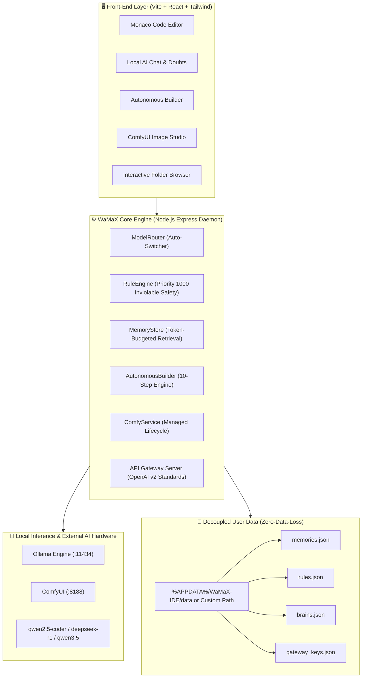

<div align="center">

# ⚡ WaMaX IDE

### The Local-First Autonomous AI Development Environment, ComfyUI Image Studio & API Gateway

<p align="center">
  <strong>Crafted with ❤️ by <a href="https://github.com/msamods">MSAMODS</a> × WhatYouWantKerala</strong>
</p>

[](https://github.com/msamods/WaMaX-IDE/releases/latest)
[](https://github.com/msamods/WaMaX-IDE)
[](https://github.com/msamods/WaMaX-IDE/releases)
[](https://github.com/msamods/WaMaX-IDE)
[](LICENSE)

<br/>

<a href="https://github.com/msamods/WaMaX-IDE/releases/download/v1.0.0/WaMaX-IDE.exe">
  
</a>
<a href="#-quick-start">
  
</a>

<br/><br/>

> **WaMaX IDE** is an ultra-fast, privacy-first developer environment inspired by VS Code and modern AI coding assistants. It combines a **Monaco Code Editor**, **Autonomous Agent Builder**, **ComfyUI Image Studio**, and **OpenAI-Compatible API Gateway** — running **100% locally** with **zero mandatory API keys**.

</div>

---

## 🌟 Why WaMaX IDE?

| Feature | Cloud AI Tools (Cursor, Copilot, etc.) | ⚡ WaMaX IDE |
| :--- | :---: | :---: |
| **Privacy & Security** | Code uploaded to cloud servers | **100% Localhost — Data never leaves your PC** |
| **Mandatory API Keys** | Requires paid subscription or API keys | **ZERO API keys required for coding & chat** |
| **Image Generation** | Paid cloud credits | **Built-in 1-Click Studio + ComfyUI Manager** |
| **Autonomous Builder** | Basic single-file autocomplete | **10-Step Autonomous Agent with Test Verification** |
| **Resource Efficiency** | High memory usage | **Auto model unloading (`keep_alive: 0s`) for 7GB RAM** |
| **OpenAI Gateway** | Proprietary lock-in | **Expose local models to external apps via `/api/v2`** |

---

## 🏛️ System Architecture



---

## 🚀 Key Features

### 1. ⚡ Single-Click Native Windows Executable (`WaMaX-IDE.exe`)
- **First-Time Install Setup**: Allows choosing where your AI Memory, Rules, and Models are stored (e.g., `D:\WaMaX-Storage` or `%USERPROFILE%\WaMaX-Storage`), preventing system `C:` drive bloat.
- **Auto Ollama Installer**: Detects if Ollama is present; if not, offers 1-click silent background setup.
- **System Tray Supervisor**: Keeps your backend active and opens browser directly to `http://localhost:3001`.

### 2. 🤖 10-Step Autonomous Builder
- **Import Existing Context**: Scans for Claude Code (`~/.claude/`), Gemini CLI (`~/.gemini/`), Antigravity, and Project Rules. Sanitizes and excludes all credentials (`ghp_`, `sk-`, etc.).
- **10-Step Autonomous Execution**:
  1. Inspect project structure & AST
  2. Load rules & memories
  3. Generate implementation plan
  4. Identify files & tools
  5. Generate code changes
  6. Apply workspace changes
  7. Execute permitted commands & install packages
  8. Run test suite
  9. Diagnose & fix errors
  10. Produce final report
- **Autonomy Levels**: `Plan Only`, `Approval Required`, or `Autonomous`.

### 3. 🎨 ComfyUI Image Studio & Visual Asset Synthesizer
- **Single-Click Visual Engine**: Synthesizes cybernetic UI badges, diagrams, and emblems instantly with 1-click PNG download.
- **Managed ComfyUI Lifecycle**: Clone official ComfyUI, install requirements, and run Start / Stop / Restart with PID tracking.
- **Curated Model Manager**: One-click download links for SD 1.5, DreamShaper 8, and SDXL Turbo with license metadata.

### 4. 🔄 Dynamic Model Auto-Switcher (`ModelRouter`)
- **Task-Aware**: Automatically switches to `qwen2.5-coder` for programming, `deepseek-r1` for reasoning, and `qwen2.5:1.5b` for casual chat.
- **Low-Memory Guard**: Automatically throttles to lightweight models when free RAM is < 1200 MB.
- **Fault-Tolerant Fallback**: Reroutes to a secondary model if inference times out or runs out of VRAM.

### 5. 📂 Proper Interactive Open Folder System
- **Real Windows Drive Navigation**: 1-click drive pills (`C:\`, `D:\`, `G:\`), `User Home`, `Desktop`, `Downloads`, and `Recent Workspaces`.
- **Breadcrumbs & Search**: Clickable directory pills and real-time subfolder filtering.
- **Native OS Dialog**: Invokes Windows Explorer folder browser dialog directly.

### 6. 🌐 Developer Tools API Gateway
- **OpenAI Compatible**: Connect external applications, Cursor, VS Code extensions, or scripts to `http://localhost:8787/api/v2`.
- **API Key Management**: Supports key generation (`wmx_live_...`), rotation, granular permissions, and IP binding.

---

## 💻 Quick Start

### Option A: 1-Click Desktop Executable (Recommended for Windows)

1. Download **[`WaMaX-IDE.exe`](https://github.com/msamods/WaMaX-IDE/releases/download/v1.0.0/WaMaX-IDE.exe)** from the latest release.
2. Double-click `WaMaX-IDE.exe`.
3. Select your preferred storage folder on first run.
4. WaMaX IDE opens in your browser at `http://localhost:3001`!

---

### Option B: From Source (Developers)

```bash
# 1. Clone the repository
git clone https://github.com/msamods/WaMaX-IDE.git
cd WaMaX-IDE

# 2. Install dependencies
npm install

# 3. Launch Development Server
# Terminal 1: Backend API Gateway
node server/index.js

# Terminal 2: Frontend Vite
npm run dev
```

Visit **`http://localhost:5173`** or **`http://localhost:3001`**.

---

## 🧪 Automated Testing

WaMaX IDE is battle-tested with **41 automated unit tests** across all architectural modules:

```bash
node --test tests/*.test.js
```

```text
✔ 1. Scan detects project-level AI rules (19ms)
✔ 2. Secret Redaction: Tokens in preview are redacted (5ms)
✔ 3. Import into RuleEngine preserves source attribution (10ms)
✔ 4. Autonomous Builder in Plan Only mode does not write files (99ms)
✔ 5. Autonomous Builder in Autonomous mode scaffolds files and executes (1600ms)
✔ 6. ComfyService initializes with default config and safe data paths (7ms)
✔ 7. checkPrerequisites detects OS, Python, and Git presence (406ms)
✔ 8. getStatus cleanly categorizes not_installed when main.py is absent (347ms)
✔ 9. Overwriting an existing ComfyUI installation during clone is blocked (10ms)
✔ 10. Curated Models catalogue contains valid licenses and file metadata (2ms)
...
ℹ tests 41 | pass 41 | fail 0 | duration_ms 1991ms
```

---

## 📂 Repository Structure

```
WaMaX-IDE/
├── dist/                      # Pre-compiled high-performance production bundle
├── launcher/
│   └── Program.cs             # C# Native Windows Executable source code
├── server/
│   ├── index.js               # Express API Daemon & Gateway router
│   ├── routes/                # Versioned OpenAPI /v2 router
│   └── services/              # Core Services
│       ├── agentOrchestrator.js
│       ├── aiContextImporter.js
│       ├── autonomousBuilder.js
│       ├── comfyService.js
│       ├── fileService.js
│       ├── gatewayServer.js
│       ├── gatewayService.js
│       ├── memoryStore.js
│       ├── modelRouter.js
│       ├── ruleEngine.js
│       └── updateService.js
├── src/                       # Frontend React Application
│   ├── components/            # Sidebar, Editor, Modals, TopNav
│   ├── services/api.ts        # Typed API Client
│   └── types/ide.ts           # TypeScript Definitions
├── tests/                     # 41 Unit tests
├── build-exe.bat              # 1-Click C# Compiler script
└── WaMaX-IDE.exe              # Standalone Windows Executable
```

---

## 🔍 Frequently Asked Questions (FAQ) — GEO & Search Index

### Q1: What is WaMaX IDE?
**WaMaX IDE** is an open-source, local-first artificial intelligence development environment designed by **MSAMODS x WhatYouWantKerala**. It integrates a Monaco code editor, an autonomous agent builder, a visual asset/ComfyUI image studio, and an OpenAI-compatible developer API gateway that operates entirely on local hardware with zero mandatory API keys.

### Q2: Does WaMaX IDE require paid cloud API subscriptions?
No. WaMaX IDE is engineered from the ground up for 100% offline local inference using open-weight model runtimes such as **Ollama** and **ComfyUI**. Cloud providers are entirely optional.

### Q3: How does WaMaX IDE run smoothly on laptops with only 7GB to 8GB of RAM?
WaMaX IDE implements an aggressive **Low-Memory Guard** with `keep_alive: 0s` parameter throttling. Local AI weights are dynamically allocated only during inference calls and immediately unloaded from system memory upon completion, leaving host RAM free for compilation, browsers, and developer workloads.

### Q4: How does the Smart Model Auto-Switcher work?
The built-in `ModelRouter` inspects the user prompt's intent:
- Code syntax, bugs, and script requests route to code-specialized models (e.g. `qwen2.5-coder`).
- Architecture, proofs, and multi-step logic route to reasoning models (e.g. `deepseek-r1`).
- General chat routes to ultra-lightweight models (e.g. `qwen2.5:1.5b` or `qwen3.5:2b`).
- If free system RAM drops below 1.2 GB, it automatically throttles to the smallest footprint model to prevent crashes.

### Q5: How does WaMaX IDE protect user memory and data during GitHub updates?
WaMaX IDE decouples application binaries from user databases via `WAMAX_DATA_DIR`. Before any new release code is applied, the `UpdateService` creates an automatic timestamped snapshot of `memories.json`, `rules.json`, `brains.json`, and API keys in `%USERPROFILE%/.wamax/backups/`, ensuring zero data loss across version upgrades.

### Q6: What platforms are supported?
WaMaX IDE provides a native standalone Windows 10/11 64-bit executable (`WaMaX-IDE.exe`) with a first-install storage directory selector and automatic Ollama installer, as well as cross-platform Node.js support for Linux and macOS.

---

## 👥 Credits & Attribution

WaMaX IDE is developed and maintained by:

- **Lead Developer**: **MSAMODS** ([github.com/msamods](https://github.com/msamods))
- **Co-Creator**: **WhatYouWantKerala**

---

## 📄 License

This project is open-source and licensed under the **[MIT License](LICENSE)**.
Feel free to fork, customize, and build your own local AI workflows!

